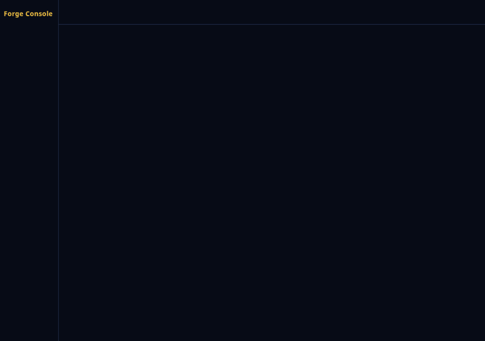
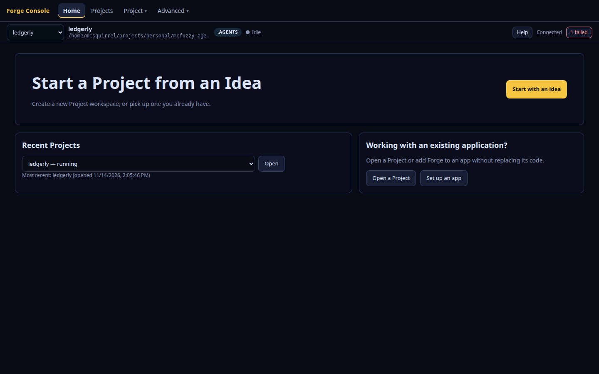
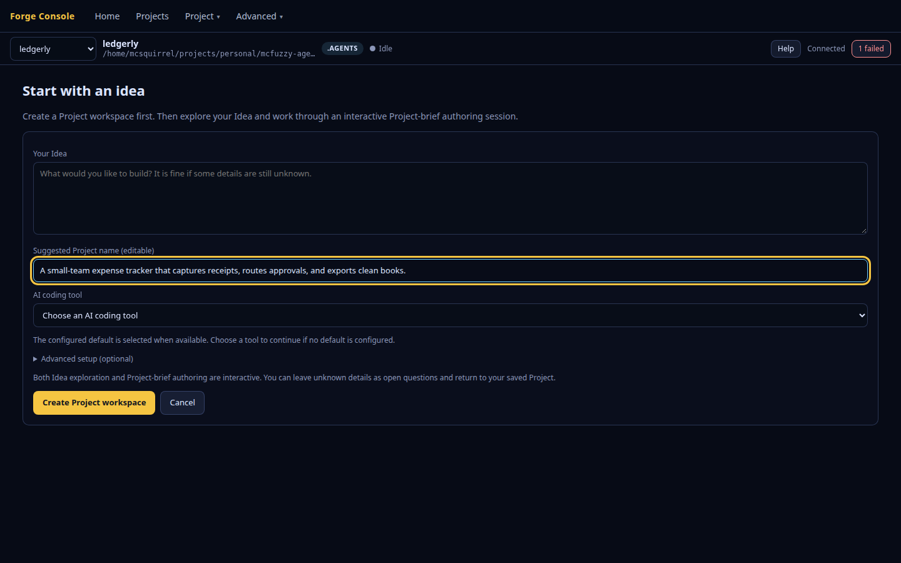
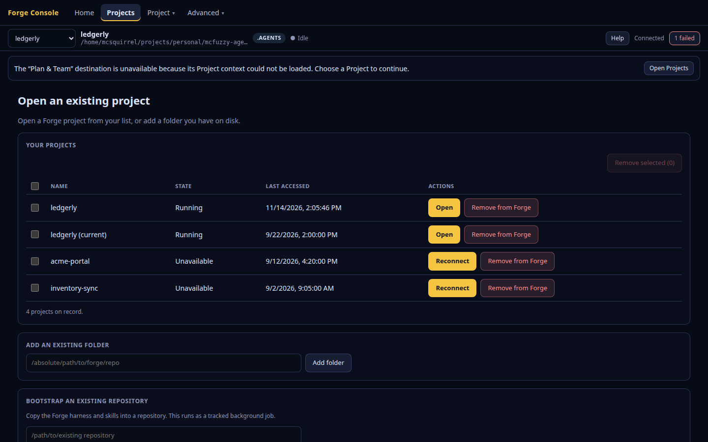
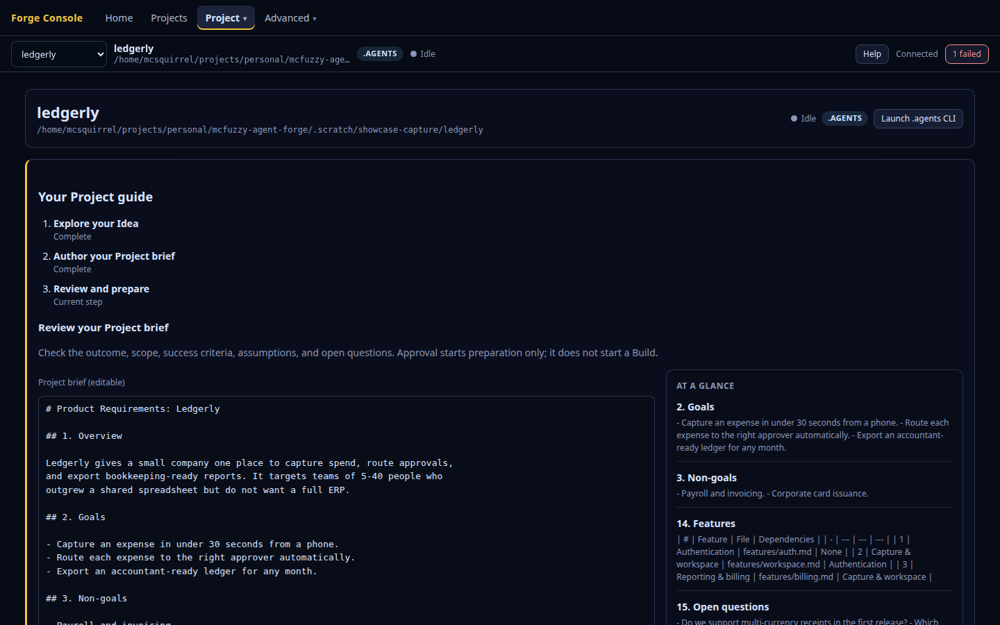
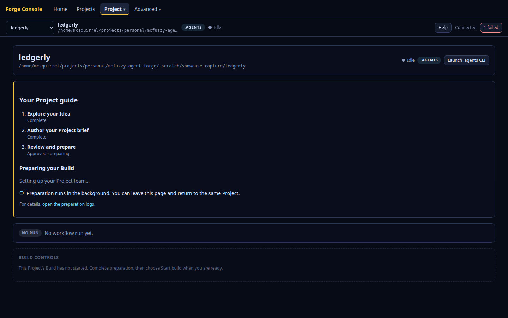
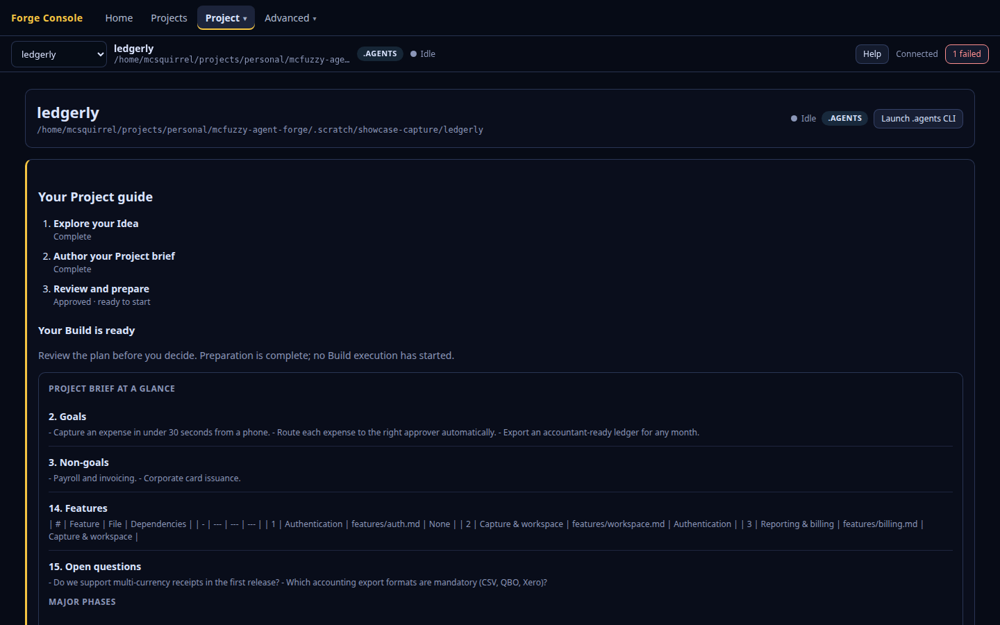
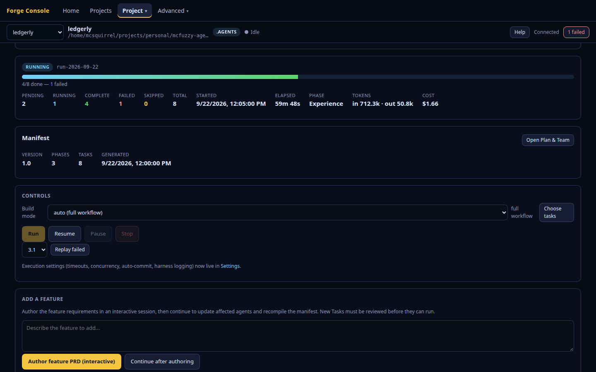
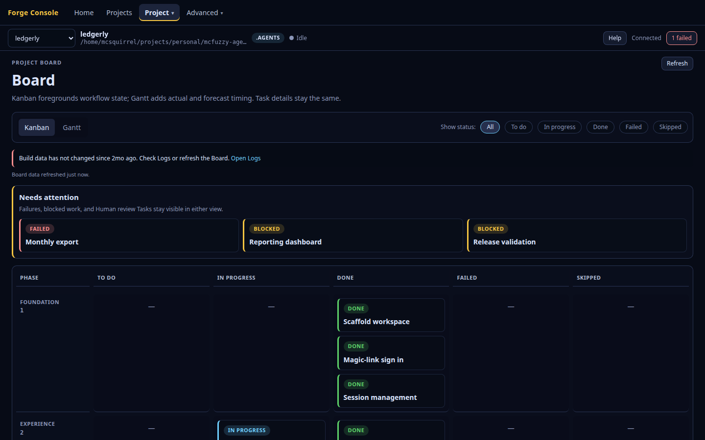
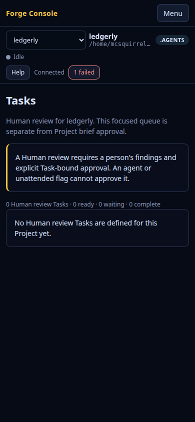

# Forge Console

A visual walkthrough from starting a project through brief review, build preparation, explicit approval, task execution, human review, and delivered files. Captures use deterministic fictional data; no authoring or build process is launched.

<video src="forge-console-tour.webm" controls autoplay loop muted playsinline></video>

## home

## new-project

## plan-and-team

## brief-review-and-build-gate

## board

## tasks

## human-review

## project-files

